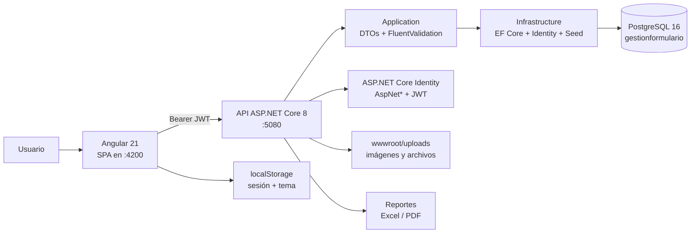
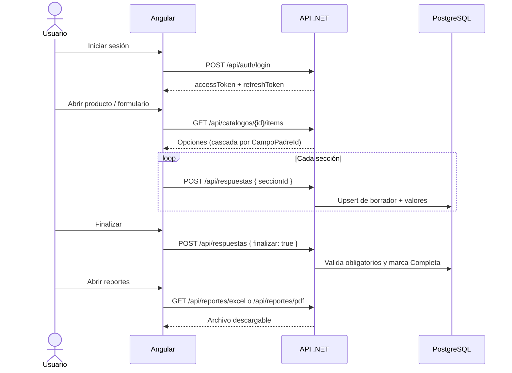
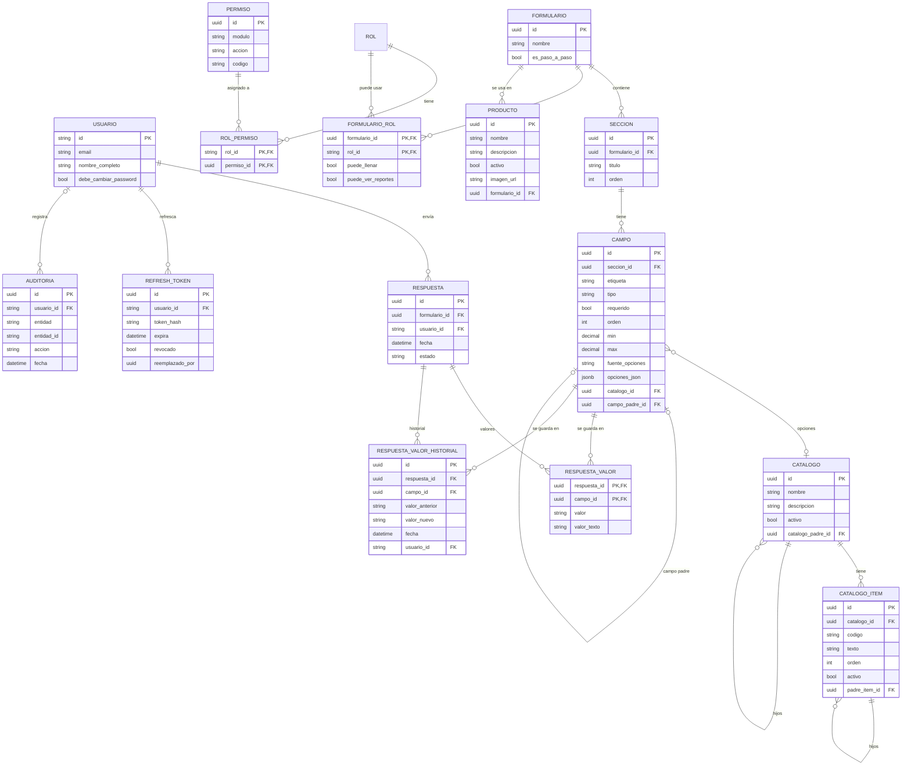

# Gestión de Formularios

Aplicación full-stack para diseñar formularios dinámicos, catálogos dependientes, respuestas parciales y reportes con exportación.

## Stack

- **Backend:** .NET 8 Web API — Clean Architecture (Domain / Application / Infrastructure / Api), EF Core + PostgreSQL (Npgsql), ASP.NET Core Identity + JWT, FluentValidation, ClosedXML y QuestPDF.
- **Frontend:** Angular 21 (componentes standalone, Angular Material, signals y Reactive Forms en el diseñador).
- **Base de datos:** PostgreSQL 16 en Docker, gestionada con migraciones de EF Core.
- **Archivos:** imágenes de producto y adjuntos en `wwwroot/uploads` (fuera de la base de datos; se guarda la URL).

## Estado del proyecto

- [x] **Etapa 1 — Base de datos y entidades**
- [x] **Etapa 2 — Seguridad** (Identity, JWT, roles, permisos y usuarios)
- [x] **Etapa 3 — API de formularios y respuestas**
- [x] **Etapa 4 — Catálogos**
- [x] **Etapa 5 — Diseñador Angular**
- [x] **Etapa 6 — Renderizador dinámico y stepper**
- [x] **Etapa 7 — Reportes y exportaciones**
- [x] **Pulida final** — tema claro, datepicker, diálogos de catálogos y plantilla de importación

---

## Arquitectura y flujo

### Flujo general



La API es la única fuente de verdad: el front oculta controles con `*hasPermission`, pero cada endpoint vuelve a validar permisos y reglas de negocio.

### Flujo de diligenciamiento



---

## Base de datos

PostgreSQL 16 (`gestionformulario`) gestionado por EF Core Code First. Las migraciones están en `src/GestionFormulario.Infrastructure/Persistence/Migrations`. Todas las claves son `Guid`, los enums se guardan como texto y la auditoría (`FechaCreacion`, `CreadoPorId`, `FechaModificacion`, `ModificadoPorId`) se rellena desde `ICurrentUserService`.

### Modelo entidad-relación



> `USUARIO` y `ROL` son las tablas de ASP.NET Core Identity (`AspNetUsers`, `AspNetRoles`, `AspNetUserRoles`, `AspNetUserClaims`, `AspNetUserLogins`, `AspNetUserTokens`, `AspNetRoleClaims`), extendidas con `DebeCambiarPassword`.

### Tablas principales

| Tabla | Propósito | Detalle importante |
| --- | --- | --- |
| `Formularios` | Definición de formularios | `EsPasoAPaso` activa el stepper. |
| `Secciones` | Agrupación de campos | Orden visual y validación por paso. |
| `Campos` | Configuración de cada control | Tipo, obligatoriedad, mínimo/máximo y fuente de opciones. |
| `Productos` | Productos que se diligencian | `FormularioId` opcional e `ImagenUrl` bajo `/uploads/productos`. |
| `Catalogos` / `CatalogoItems` | Listas reutilizables y jerarquías | Multinivel con `CatalogoPadreId` + `PadreItemId`; borrado lógico. |
| `Respuestas` | Borradores y respuestas finales | Estado `Borrador` o `Completa`, ligada al usuario. |
| `RespuestaValores` | Valores actuales | Clave compuesta `(RespuestaId, CampoId)`; `ValorTexto` guarda la presentación histórica. |
| `RespuestaValorHistoriales` | Trazabilidad de cambios | Guarda valor anterior/nuevo y usuario. |
| `Permisos` / `RolesPermisos` | Autorización fina | Código estable tipo `Catalogos.Editar`. |
| `FormulariosRoles` | Acceso por formulario | `PuedeLlenar` y `PuedeVerReportes`. |
| `RefreshTokens` | Rotación de sesión | Hash del token, expiración y reemplazo. |
| `Auditorias` | Registro de operaciones | Entidad, Id, acción y fecha. |

---

## Puesta en marcha

Requisitos: .NET 8 SDK, Docker y Node 20+.

```bash
# 1. Base de datos
docker compose up -d db

# 2. Migraciones (dotnet-ef 8 está en el manifest local)
dotnet tool restore
dotnet ef database update \
  --project src/GestionFormulario.Infrastructure \
  --startup-project src/GestionFormulario.Api

# 3. Compilación y tests
dotnet build GestionFormulario.sln
dotnet test GestionFormulario.sln

# 4. API (siembra permisos, rol Admin y usuario admin)
dotnet run --project src/GestionFormulario.Api

# 5. Frontend Angular
cd frontend
npm install
npm start   # http://localhost:4200
```

- Para desarrollo con el frontend, levantar el API en HTTP puro para evitar el salto HTTPS de IIS Express que rompe CORS:

  ```bash
  cd src/GestionFormulario.Api
  dotnet bin/Debug/net8.0/GestionFormulario.Api.dll --urls http://localhost:5080
  ```

  y mantener `apiUrl: 'http://localhost:5080/api'` en `frontend/src/environments/environment.ts`.

- Swagger: el puerto que indique la consola (perfil IIS Express: `http://localhost:36835/swagger` / `https://localhost:44366/swagger`).
- Health check: `GET /health`.
- Usuario seed: `admin@gestionformulario.local` / `Admin123!` (`DebeCambiarPassword = true`). En la base local de desarrollo la contraseña se cambió a `Admin1234!` durante la verificación.

> El usuario y la contraseña del seed se leen de `Seed` en `appsettings.json`. Cámbialos antes de desplegar.

## Configuración

| Dónde | Clave | Valor de desarrollo |
| --- | --- | --- |
| `src/GestionFormulario.Api/appsettings.json` | `ConnectionStrings:DefaultConnection` | `Host=localhost;Port=5432;Database=gestionformulario;...` |
| `src/GestionFormulario.Api/appsettings.json` | `Jwt:Key` | `dev-key-cambiar-en-produccion-1234567890abcdef` (**cambiar en producción**) |
| `src/GestionFormulario.Api/appsettings.json` | `Jwt:AccessTokenMinutes` / `RefreshTokenDays` | `15` / `7` |
| `src/GestionFormulario.Api/appsettings.json` | `Seed:AdminEmail` / `Seed:AdminPassword` | `admin@gestionformulario.local` / `Admin123!` |
| `frontend/src/environments/environment.ts` | `apiUrl` | `http://localhost:5080/api` |
| `localStorage` | `gestion-formulario-usuario` | Sesión del usuario (access + refresh token) |
| `localStorage` | `gestion-formulario-tema` | Preferencia claro/oscuro |

---

## Seguridad

Flujos disponibles:

- `POST /api/auth/login` → `accessToken` (JWT, 15 min) + `refreshToken` (7 días, rotado en cada uso).
- `POST /api/auth/refresh` → nuevo par de tokens; reutilizar un token ya rotado revoca todos los tokens del usuario.
- `POST /api/auth/cambiar-password` → obligatorio en el primer login; hasta que se ejecuta, el resto de la API responde `403` con `code: CAMBIO_PASSWORD_REQUERIDO`.
- `POST /api/auth/olvide-password` / `reset-password`, `POST /api/auth/logout`, `GET /api/auth/mis-permisos`.
- `GET/POST/PUT/DELETE /api/usuarios` y `/api/roles`, más `GET /api/roles/permisos-disponibles` y `PUT /api/roles/{id}/permisos`.

El código de permiso se declara con `[HasPermission("Catalogos.Editar")]` y se resuelve mediante una política dinámica `Permiso:{codigo}` a partir de las claims `permiso` del JWT. Los roles `Admin` y los usuarios administradores no se pueden editar/eliminar. Las respuestas de error usan `ProblemDetails` con un campo `code` estable (`VALIDACION`, `CREDENCIALES_INVALIDAS`, `ACCESO_DENEGADO`, etc.).

## Catálogos

- `GET /api/catalogos`, `GET /api/catalogos/{id}`, `POST /api/catalogos`, `PUT /api/catalogos/{id}` y `DELETE /api/catalogos/{id}` con permisos `Catalogos.Ver/Crear/Editar/Eliminar`.
- `GET /api/catalogos/{id}/items?padreItemId=&buscar=&soloActivos=true` devuelve opciones listas para `mat-select` con búsqueda. En catálogos dependientes exige `padreItemId` y valida que el item padre pertenezca al catálogo padre.
- CRUD de ítems: `POST /api/catalogos/{catalogoId}/items`, `PUT /api/catalogos/items/{itemId}` y `DELETE /api/catalogos/items/{itemId}`.
- Importación `POST /api/catalogos/{id}/importar` (multipart/form-data; campo `archivo` y opcional `reemplazar=true`) de `.csv` o `.xlsx` usando CsvHelper y ClosedXML. Columnas aceptadas: `Codigo`, `Texto`, `Orden` y `PadreItemCodigo`.
- La vista descarga una plantilla CSV desde **Ver ítems → Descargar plantilla** y muestra la ayuda de columnas en la zona de importación.
- Jerarquía multinivel (País → Departamento → Ciudad) mediante `CatalogoPadreId` + `PadreItemId`. Se rechazan ciclos, padres inexistentes, padres inactivos y padres de otro catálogo.
- Borrado lógico: al eliminar un catálogo se desactivan sus descendientes e ítems; `RespuestaValor.ValorTexto` conserva la instantánea histórica aunque el item cambie o se desactive.
- Códigos de error estables: `CATALOGO_DUPLICADO`, `CATALOGO_NO_ENCONTRADO`, `CATALOGO_CICLICO`, `CATALOGO_PADRE_INVALIDO`, `PADRE_ITEM_REQUERIDO`, `PADRE_ITEM_INVALIDO`, `ITEM_DUPLICADO`, `ITEM_NO_ENCONTRADO`, `ARCHIVO_VACIO`.

## Formularios y respuestas

- `GET /api/formularios`, `GET /api/formularios/{id}`, `POST /api/formularios`, `PUT /api/formularios/{id}` y `DELETE /api/formularios/{id}` con permisos `Formularios.Ver/Crear/Editar/Eliminar`.
- `GET /api/formularios` solo devuelve los formularios sin restricción de roles o los permitidos al usuario; Admin ve todos.
- `EsPasoAPaso` habilita el stepper. Tipos soportados: `Texto`, `Entero`, `Decimal`, `Email`, `Fecha`, `Hora`, `Moneda`, `Porcentaje` y `Lista`. `Fecha` usa `AAAA-MM-DD` y `Hora` usa `HH:mm` (se normalizan en servidor; el texto mostrado en reportes usa el formato local `es-ES`).
- Opciones de lista: `FuenteOpciones = Manual` guarda `[{ "valor", "etiqueta" }]` en `jsonb`; `Catalogo` usa ítems activos y respeta `CampoPadreId` con validación dependiente en servidor.
- Normalización: `Valor` se guarda en formato invariante; `ValorTexto` conserva la presentación `es-ES` (`1.234,56 €`, `15,00 %`) para que el histórico no cambie.
- `POST /api/respuestas` con `{ id, formularioId, seccionId, valores, finalizar }`:
  - sin `id` crea un borrador; con `id` lo reanuda.
  - con `seccionId` valida solo los campos obligatorios de esa sección ("Guardar y continuar").
  - con `finalizar: true` valida todos los obligatorios, pasa de `Borrador` a `Completa` y persiste todos los valores.
  - una respuesta completada ya no admite guardados parciales (409 `RESPUESTA_COMPLETA`).
- `GET /api/respuestas?formularioId=&desde=&hasta=&estado=&page=&pageSize=`, `GET /api/respuestas/{id}` y `DELETE /api/respuestas/{id}` con permisos `Respuestas.*`.
- Los usuarios no administradores solo ven y modifican sus propias respuestas; Admin ve todas.

Códigos de error añadidos: `FORMULARIO_NO_ENCONTRADO`, `FORMULARIO_DUPLICADO`, `FORMULARIO_EN_USO`, `CAMPO_REQUERIDO`, `VALOR_INVALIDO`, `VALOR_FUERA_RANGO`, `OPCION_NO_VALIDA`, `RESPUESTA_COMPLETA`, `RESPUESTA_NO_ENCONTRADA`.

---

## Frontend Angular

La aplicación vive en `frontend/` y usa componentes standalone, Angular Material 21, signals y Reactive Forms en el diseñador.

- `npm install` y `npm start` → `http://localhost:4200`. La API se consume desde `http://localhost:5080/api`.
- Autenticación: `AuthService` guarda la sesión en `localStorage`; `authInterceptor` añade el `Bearer` y reintenta una vez tras `POST /api/auth/refresh` cuando recibe un 401.
- `authGuard` y `permissionGuard` protegen las rutas. Si el usuario debe cambiar su contraseña, se le redirige a `/cambiar-password` antes de acceder al panel.
- El menú lateral es responsive y muestra **Mis productos**, **Configuración** y **Cambiar contraseña**, filtrados por permisos. El acceso a *Mis formularios*, *Catálogos* y *Reportes* se hace desde el panel o por URL directa. Con menos de 900 px el sidenav pasa a modo `over`.
- **Productos:** alta, edición, cambio de imagen y asociación con un formulario.
- **Formularios:** alta, edición, borrado con diálogo de confirmación y diseñador basado en `FormArray` para secciones/campos. Permite reordenar, elegir los 9 tipos soportados, definir mínimos/máximos, opciones manuales u opciones de catálogo con campo padre dependiente.
- **Catálogos:** alta/edición de catálogos e ítems en diálogos Material, detalle lateral, consulta de opciones e importación `.csv`/`.xlsx` con plantilla descargable y opción `reemplazar`.
- Notificaciones con `MatSnackBar`; los errores `ProblemDetails` se muestran usando `detail`, `title` o `code`.
- La API habilita CORS para `http://localhost:4200` y `http://127.0.0.1:4200`.

> Los tests Karma se omitieron al generar el proyecto porque el entorno no dispone de Chrome/Edge. La comprobación se realizó con `npm run build` y prueba manual en navegador (login, diseñador, guardado, catálogos, importación y vista móvil).

## Renderizador dinámico

- **Mis formularios** (`/app/mis-formularios`) lista los formularios accesibles del usuario; **Administrar formularios** (`/app/formularios`) mantiene el alta/edición.
- **Vista previa**: desde el diseñador (o `/app/formularios/:id/vista-previa`) se renderiza el formulario tal como lo verán los usuarios, sin guardar datos.
- **Diligenciamiento**: `/app/mis-formularios/:id/llenar` construye los controles en tiempo de ejecución según el tipo de campo (`Texto`, `Entero`, `Decimal`, `Email`, `Fecha`, `Hora`, `Moneda`, `Porcentaje`, `Lista`) con validación de obligatorios y formato.
- Las listas de catálogo se cargan desde `GET /api/catalogos/{id}/items`; cuando el campo tiene `CampoPadreId`, las opciones se filtran en cascada y se limpia el valor hijo si deja de ser válido.
- Con `EsPasoAPaso = true` se usa `mat-stepper` lineal: *Guardar y continuar* envía `seccionId` (validación parcial en servidor) y el último paso envía `finalizar: true`.
- Los borradores se reanudan automáticamente; `RespuestaListItemDto` incluye `usuarioId` para que Admin no abra por error el borrador de otro usuario.

## Reportes y exportaciones

- Vista `Reportes` (`/app/reportes`) con filtros por formulario, estado, rango de fechas y paginación.
- Tabla de respuestas guardadas con columnas dinámicas por campo del formulario seleccionado.
- Los valores de catálogo se muestran con su texto histórico (`ValorTexto`), no con el Id.
- Exportación a Excel (ClosedXML) y PDF (QuestPDF) con diseño corporativo (encabezado azul, bordes, paginación en PDF).
- Permisos `Reportes.Ver` y `Reportes.Exportar`; los usuarios no administradores solo ven sus propias respuestas.
- Endpoints: `GET /api/reportes`, `GET /api/reportes/excel`, `GET /api/reportes/pdf`.

---

## Mapa de rutas

### API

| Controller | Base | Responsabilidad |
| --- | --- | --- |
| `AuthController` | `/api/auth` | Login, refresh, cambio/reset de password, logout, permisos. |
| `ProductosController` | `/api/productos` | Alta, edición e imágenes de productos. |
| `FormulariosController` | `/api/formularios` | Diseñador y consulta de formularios. |
| `CatalogosController` | `/api/catalogos` | Catálogos, ítems dependientes e importación. |
| `RespuestasController` | `/api/respuestas` | Borradores, guardado parcial y finalización. |
| `ReportesController` | `/api/reportes` | Consulta y exportación Excel/PDF. |
| `UsuariosController` / `RolesController` | `/api/usuarios`, `/api/roles` | Administración de identidades y permisos. |
| `ArchivosController` | `/api/archivos` | Subida de archivos a `wwwroot/uploads`. |

### Frontend

| Ruta | Vista |
| --- | --- |
| `/login`, `/cambiar-password` | Autenticación y primer cambio de password. |
| `/app/productos` | Mis productos (diligenciamiento). |
| `/app/configuracion/productos` | Administración de productos. |
| `/app/formularios`, `/app/formularios/nuevo`, `/app/formularios/:id/editar` | Administración y diseñador. |
| `/app/formularios/:id/vista-previa` | Vista previa sin guardar. |
| `/app/mis-formularios`, `/app/mis-formularios/:id/llenar` | Formularios accesibles y renderizador. |
| `/app/catalogos` | Catálogos e importación. |
| `/app/reportes`, `/app/dashboard` | Reportes y panel. |
| `/app/roles`, `/app/usuarios` | Seguridad. |
| `/app/respuestas/:id/historial` | Historial de valores. |

## Estructura

```
src/
├── GestionFormulario.Domain        # entidades, enums y contratos (sin dependencias externas)
├── GestionFormulario.Application   # DTOs, validators y casos de uso
├── GestionFormulario.Infrastructure# EF Core, Identity, migraciones, auditoría, seed y servicios
└── GestionFormulario.Api           # controllers, middleware y composición
tests/
└── GestionFormulario.Tests
frontend/
└── src/app/
    ├── core/       # modelos, servicios HTTP, interceptor, guards
    ├── features/   # auth, productos, formularios, catálogos, renderer, reportes, seguridad
    └── shared/     # layout, menú, directiva hasPermission, diálogos
```

## Verificación

```bash
dotnet build GestionFormulario.sln
dotnet test GestionFormulario.sln        # 16/16
cd frontend && npm run build             # bundles lazy sin errores
```

Última verificación manual: login, diseñador, guardado por pasos, catálogos con diálogos, importación con plantilla, cambio de tema y vista móvil. Sin errores en consola del navegador.

## Decisiones destacadas

- Todos los IDs son `Guid`; los enums se persisten como texto para legibilidad.
- `RespuestaValor` usa clave compuesta `(RespuestaId, CampoId)` y guarda `ValorTexto`: una instantánea del texto del ítem de catálogo, de modo que el histórico no cambia si el ítem se edita o se desactiva.
- Las relaciones de catálogos dependientes usan `DeleteBehavior.Restrict` para evitar borrados accidentales.
- `SaveChangesAsync` rellena auditoría (`FechaCreacion`, `CreadoPorId`, etc.) a partir de `ICurrentUserService`.
- El rol Admin omite las comprobaciones de permiso en el cliente, pero el servidor sigue siendo la única fuente de verdad.
- Se incluye `FormularioRol` desde el inicio para no necesitar una migración posterior al implementar permisos por formulario.
- Las credenciales visibles en `appsettings.json` son solo de desarrollo; deben sustituirse por secretos antes de desplegar.
